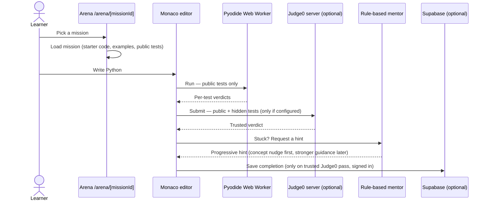
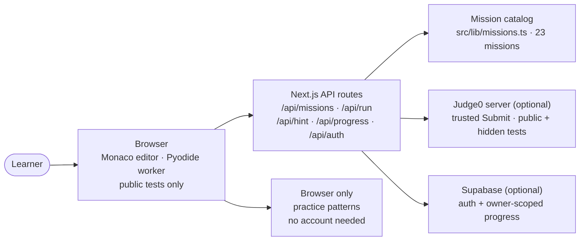
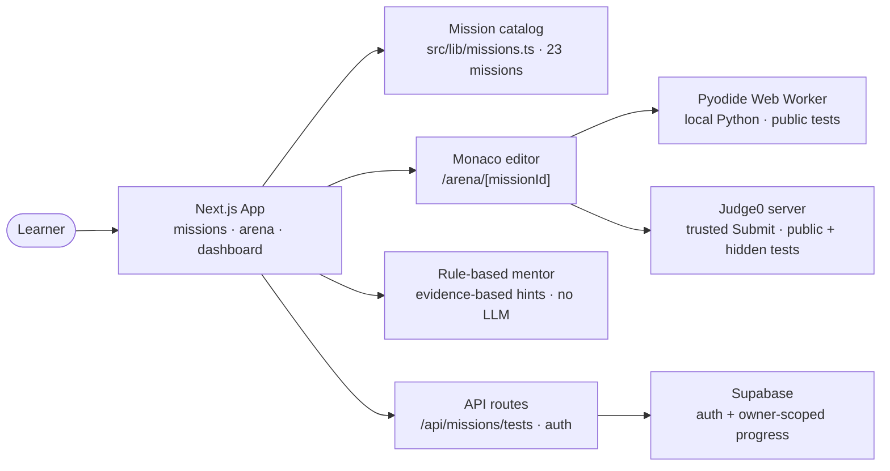

# CodeQuest AI

**Learn Python by solving missions, with a mentor that explains — not just grades.**

Live demo (team deployment): https://codequest-xi-eight.vercel.app

CodeQuest AI (original project name: Vortexa) is a guided Python learning workspace. Learners pick a coding mission, write Python in the browser, run it against public tests, and get progressive, rule-based mentor hints when they get stuck. Trusted grading and saved progress are optional and need a server setup.

## What it does

- **Mission catalog:** 23 authored missions in `src/lib/missions.ts` — 9 Beginner, 13 Intermediate, 1 Advanced, about 6 hours of estimated practice in total. Each mission has a stable ID/slug, topic, category, concepts, duration, constraints, examples, starter code, and non-solution hint metadata.
- **Coding arena:** a Monaco-based editor at `/arena/[missionId]`, with per-test verdicts, a dashboard, and a missions list at `/missions`.
- **Local Python execution:** Run executes real Python in the browser with Pyodide in a Web Worker — no server or account needed for practice.
- **Trusted Submit:** Submit runs the full public + hidden suite on a configured Judge0 server and only saves a completion when the trusted result passes. Without Judge0 configured, Submit shows an actionable configuration message and never reports false success.
- **Deterministic mentor:** hints are rule-based and evidence-based. No LLM provider is called. Hints explain the mistake category and suggest the next step without revealing the solution.
- **Adaptive learner:** learner patterns and progress are tracked from attempts, with empty states on the dashboard until real data exists.
- **Accounts (optional):** Supabase email sign-in/sign-up with owner-scoped saved progress. Local practice works without it.

Mission drafts under `missions/drafts/` and `Pankaj mission/drafts/` are team drafts and are not automatically promoted into the canonical catalog.

## How a mission attempt works



## Run vs. Submit — read this first

| Action | What it checks | Where it runs |
| --- | --- | --- |
| Run (Local Python) | Public tests only | Browser, Pyodide Web Worker |
| Submit (Local Python) | Public tests only | Browser, Pyodide Web Worker |
| Submit (Live Judge0) | Public + hidden tests | Configured Judge0 server, trusted grading |

Local mode is genuine Python execution, but the browser worker is not a server-side security boundary or a trusted grading path. Use Live Judge0 when trusted grading or persistent progress is needed.

## How evaluation works

The execution contract is discriminated by format:

- `function` — invokes the configured Python function with JSON-compatible test arguments and compares its returned value. 22 of the 23 missions use this format.
- `stdin_stdout` — supplies text through standard input and compares the program's captured standard output exactly. 1 mission (`count-input-lines`) uses this format.

Public tests are returned by `GET /api/missions/tests` for local browser execution. Private cases stay in the server-only test catalog and are used only for a configured Live Judge0 Submit.

## Mission catalog

All 23 missions, exactly as defined in `src/lib/missions.ts`. Times are the per-mission estimates stored with each mission (373 minutes total, about 6 hours).

| Mission | Difficulty | Category | Time |
| --- | --- | --- | --- |
| Sum of Two Numbers | Beginner | Fundamentals | 8 min |
| Even or Odd | Beginner | Conditionals | 10 min |
| Sum from 1 to N | Beginner | Loops | 12 min |
| Find the Largest Number | Beginner | Arrays | 15 min |
| Count Vowels | Beginner | Strings | 14 min |
| Factorial Number | Beginner | Loops | 12 min |
| Palindrome Check | Beginner | Strings | 12 min |
| Reverse String | Beginner | Strings | 10 min |
| Count Input Lines | Beginner | Input / Output | 12 min |
| Largest of Three | Intermediate | Conditionals | 14 min |
| Two Sum | Intermediate | Arrays | 20 min |
| Second Largest Number | Intermediate | Arrays | 18 min |
| Binary Search | Intermediate | Searching & Sorting | 18 min |
| Sort Numbers | Intermediate | Searching & Sorting | 20 min |
| Recursive Factorial | Intermediate | Recursion | 16 min |
| Character Frequency | Intermediate | Hash Maps | 16 min |
| Balanced Brackets | Intermediate | Stacks & Queues | 18 min |
| Queue Operations | Intermediate | Stacks & Queues | 20 min |
| Linked List Cycle | Intermediate | Linked Lists | 20 min |
| Maximum Tree Depth | Intermediate | Trees | 18 min |
| Graph Reachability | Intermediate | Graphs | 22 min |
| Fibonacci with Memoization | Intermediate | Dynamic Programming | 18 min |
| Longest Substring | Advanced | Strings | 30 min |

## Data flow — where things live



- **Browser:** the editor, the Pyodide worker, and local practice patterns. Recurring-mistake review works without an account and stays in the browser.
- **Server:** the API routes serve public tests, run bounded execution, generate progressive hints, and own all progress writes. Hidden tests never leave the server.
- **Supabase (optional):** authentication plus owner-scoped reads of attempts, completions, and mistake summaries. Writes are server-only (`service_role`, migration `002_server_owned_progress.sql`); the browser never writes progress directly.
- **Judge0 (optional):** the only trusted grading path. A completion is saved only when a trusted Judge0 Submit passes all required tests.

## API

| Route | Method | Purpose |
| --- | --- | --- |
| `/api/missions` | GET | List the mission catalog |
| `/api/missions/[id]` | GET | One mission by ID |
| `/api/missions/tests` | GET | Public tests for local browser execution |
| `/api/run` | POST | Bounded code execution (128 KiB total, 64 KiB source, 8 s per test, 30 s deadline) |
| `/api/hint` | POST | Progressive, rule-based mentor hints |
| `/api/progress` | GET | Saved progress (authenticated, owner-scoped) |
| `/api/auth/sign-up` | POST | Supabase email sign-up |
| `/api/auth/sign-in` | POST | Supabase email sign-in |

## Tech stack

| Layer | Choice |
| --- | --- |
| Framework | Next.js 16.4.0 (App Router) · React 19.3.0 · TypeScript 5 |
| Styling | Tailwind CSS v4 · `@tailwindcss/turbopack` |
| Editor | Monaco Editor (`@monaco-editor/react` 4.7.0) |
| Python runtime | Pyodide 0.29.5 (Web Worker, jsDelivr CDN) |
| Trusted grading | Judge0 (optional, self-hosted or compatible provider) |
| Accounts + data | Supabase (`@supabase/supabase-js` 2.117.3, optional) |
| Landing visual | Spline (`@splinetool/react-spline` 4.1.0) |
| Tests | Vitest 2.1.8 (`npm test`) · ESLint 9 (`npm run lint`) |

## Quick start — local practice, no account needed

Prerequisites: Node.js 20+ and npm.

```bash
npm install
cp .env.example .env.local
npm run dev
```

Then open the app and verify:

- `http://localhost:3000/missions`
- `http://localhost:3000/dashboard`
- `http://localhost:3000/arena/sum-of-two-numbers`

On Windows PowerShell, use `Copy-Item .env.example .env.local` instead of `cp`. The first local run downloads the version-pinned Pyodide runtime and WebAssembly/standard-library assets from the jsDelivr CDN; initial network access is required unless those assets are already cached.

## Optional setup — accounts and trusted grading

### Supabase project setup

1. Create a Supabase project.
2. Apply all migrations in `supabase/migrations/` in order (`001_phase3_persistence.sql`, `002_server_owned_progress.sql`, `003_adaptive_learner_intelligence.sql`). Migration `002` removes browser writes to attempts, completions, and mistake summaries, retaining authenticated owner-scoped reads while reserving writes for the server-only `service_role`.
3. Enable email auth in Supabase Authentication if you want password sign-in and sign-up.
4. Keep the server-side keys in local environment variables only.

```bash
# From the project root, use the Supabase CLI if available:
supabase db push
```

Or paste the SQL from each migration in numeric order into the Supabase SQL editor.

Create your first account through the Supabase Auth UI or the API routes `POST /api/auth/sign-up` and `POST /api/auth/sign-in`. Include the access token as `Bearer <token>` in the Authorization header for protected routes.

### Environment variables

Copy `.env.example` to `.env.local` and replace the placeholders:

- `SUPABASE_URL`, `SUPABASE_ANON_KEY` — project URL and anon key for server-side auth APIs.
- `NEXT_PUBLIC_SUPABASE_URL`, `NEXT_PUBLIC_SUPABASE_ANON_KEY` — the same project URL and anon/publishable key for browser sign-in. These are public client values; never put a service-role key in a `NEXT_PUBLIC_*` variable.
- `SUPABASE_SERVICE_ROLE_KEY` — service-role key for server-side writes; never expose it via `NEXT_PUBLIC_*`.
- `JUDGE0_API_URL` — required for trusted Submit verification; optional for Local Python Run. Base URL from a Judge0-compatible provider or self-hosted deployment. The app appends `/submissions`.
- `JUDGE0_API_KEY` — optional Judge0 API key. `JUDGE0_AUTH_HEADER`, `JUDGE0_AUTH_PREFIX`, and `JUDGE0_PYTHON_LANGUAGE_ID` (defaults to `71`, Judge0 CE Python 3.8.1) are optional overrides.
- `NEXT_PUBLIC_LOCAL_PYTHON_TIMEOUT_MS` — optional local Pyodide execution timeout in milliseconds (default 10000; clamped between 1000 and 30000).
- `MENTOR_EVIDENCE_SECRET` — optional server-only random secret of at least 32 bytes. Set the same value on all production instances so signed mentor evidence works across requests and restarts. If unset, a process-local random key is used; outstanding evidence expires on restart.

The arena starts in Local Python mode. The local runner supports the catalog's function and stdin/stdout formats with Python standard-library-compatible code. Arbitrary third-party packages, native extensions, and secure hidden-test grading are not provided by this browser runtime.

## Verification checklist

- In Local Python mode, confirm actual Python executes in the browser worker and checks only public cases.
- In Live Judge0 mode with Supabase configured, a persisted attempt is created for an authenticated learner.
- A mission completion row is upserted only when a trusted Live Judge0 Submit result shows all required tests passed.
- Dashboard metrics come from persisted data and show empty states when no data is available.

Run the checks with:

```bash
npm run lint
npm test
npm run build
```

## Security notes

- Learner ownership is enforced from the authenticated user identity. Client-supplied IDs are not trusted for writes.
- Full source snapshots are intentionally not stored; only attempt metadata and classification data are persisted.
- Hidden tests, privileged execution output, and provider internals are never exposed to learner-facing records.
- Run and Submit requests are bounded to 128 KiB total and 64 KiB of source, with an eight-second per-test limit and a 30-second execution deadline. Judge0 is configured with resource caps and network access disabled where the provider supports those fields; the actual isolation guarantees depend on the selected Judge0 deployment.
- The run route uses an in-memory sliding-window limit (5 requests per minute per verified learner; 20 per minute in one shared anonymous bucket). This is process-local and is not globally consistent across serverless instances or restarts. Configure an upstream/shared rate limiter at deployment for production-wide abuse protection.
- No hidden tests or server credentials are sent to Pyodide. Only public test inputs/expected values are supplied by the public-test endpoint.

## Architecture



## Project structure

```text
src/app/            Pages (missions, arena/[missionId], dashboard, auth) and API routes (auth, missions, run, hint, progress)
src/components/     ArenaWorkspace, CodeEditor, MentorPanel, MissionGrid, MissionCard, TestResults,
                    SplineScene, LearnerProgressDashboard, AdaptiveLearnerSection, LocalPatternsSection,
                    AuthWidget, Navbar
src/lib/            Mission catalog, mentor evidence, adaptive learner, Pyodide runner, local Python,
                    execution client, Judge0 client, rate limit, Supabase
supabase/           3 SQL migrations (001 persistence, 002 server-owned progress, 003 adaptive learner)
missions/drafts/    Team mission drafts — not in the canonical catalog
```

Tests: 18 test files across `src/lib` (12), `src/app/api` (5), and `src/components` (1). Run them with `npm test` (Vitest).

## Honest limits

- **No LLM anywhere.** The mentor is rule-based (`mistakePatterns` + progressive hint levels). It classifies the mistake and nudges; it never writes or reveals the solution.
- **No trusted grading without Judge0.** Local Submit only checks public tests in the browser. A completion is saved only on a trusted Judge0 pass.
- **No accounts without Supabase.** Progress, attempts, and completions need a configured Supabase project; without it the app is local practice only.
- **Browser Python is standard library only.** Third-party packages and native extensions are not supported by the Pyodide runtime, and hidden-test grading is never done in the browser.
- **Rate limits are process-local.** The run route's sliding-window limit does not hold across serverless instances or restarts.
- **Drafts are not missions.** Files under `missions/drafts/` and `Pankaj mission/drafts/` are team working drafts; only the 23 missions in `src/lib/missions.ts` are the catalog.

## Team

Built by a team:

- Aman Shejul — team lead
- Swapnil Thite — backend and execution engine (Next.js setup and missions API)
- Pankaj Dandekar — missions and content design
- Yash Ambekar — AI mentor engine

This repository is an imported copy of the original team repository, [AmanShejul/vortexa](https://github.com/AmanShejul/vortexa). Commit history is preserved from the original.
